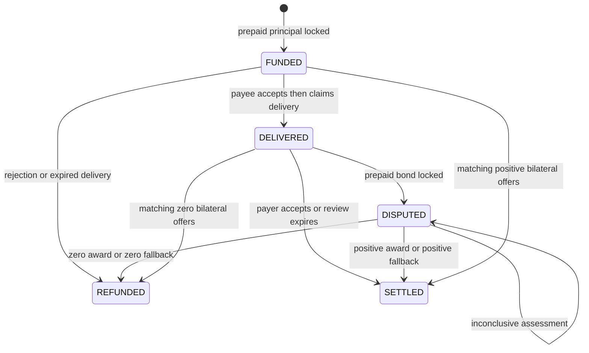

# Architecture

## Custody boundary

Each `DisputeEscrow` deployment has one immutable `funding_owner`. Escrows may have different payees, but their payer is always that owner. Builders deploy separate books for separate payers, including Intelligent Contract payers.

All native GEN received by a book belongs to that funding owner. This includes intentional third-party gifts, direct transfers, malformed calls and value retained after rejected consensus. There is no per-sender refund promise for those transfers. The SDK checks the configured owner before submitting a deposit.

This ownership rule addresses a verified Studio behavior: a majority-rejected payable transaction can credit the receiving account even though its contract state does not commit. No refund written inside that rejected execution can survive. Version 2 therefore has only one payable entry point, deterministic `deposit`. Evidence evaluation and allocation always use existing prepaid credit in nonpayable calls.

`reconcile_deposits` compares the native balance with all existing principal, bond and credit liabilities. A positive difference becomes funding-owner credit. Anyone may trigger reconciliation, but the caller cannot choose its beneficiary. Reconciliation first tracks pending withdrawals until authenticated self-messages emitted at parent finality acknowledge their native debits. It rejects while acknowledgements remain pending, so outgoing reserved value cannot become a false deposit. Existing payee credits and locked money remain liabilities throughout the calculation. A deficit causes a revert rather than reallocating someone else's claim.

## Evidence and consensus

Creation, delivery, dispute and supplements each fetch public HTTPS text and commit the exact bytes through strict equality consensus. The caller supplies the SHA-256 digest. A later origin change cannot rewrite a committed snapshot.

At adjudication, each evaluator independently fetches every committed URL and verifies its digest. If an origin is unavailable or returns different bytes, the evaluator uses the previously consensus-committed snapshot after verifying its digest again. Every prompt includes the original terms, delivery, dispute, supplements and the actual submitting addresses.

The leader proposes a structured assessment. Each validator independently runs the same evidence evaluation and requires exact equality on:

- `conclusive`
- `payee_bps`
- `payer_bad_faith`

No tolerance, weighted-score comparison or leader-only adjudication is used. Shares are canonical 100-basis-point increments. Settlement uses that exact bound share, with integer arithmetic. Bad faith is valid only for conclusive full delivery. Inconclusive output has zero share and no penalty and does not settle.

The prose reason and fetch-source observations are explanatory metadata. They do not become precedent, affect later prompts, change deadlines or drive payments. Future panels never consume a prior leader's reason as binding law. Source observations may differ between evaluators; exact economic agreement is still required.

## Lifecycle and liveness

Matching bilateral offers are available in every open state. The diagram shows representative edges; the API supports every split from 0 to 10000 basis points in each open state.

The payee must accept the engagement before claiming delivery. That acceptance includes the bond, response period, resolution deadline policy and fallback allocation. Before the response cutoff, each party may submit up to three supplements. Both parties can close evidence early; one party cannot unilaterally remove the other's response opportunity.

After the resolution deadline, new model adjudication is disabled and anyone can apply the recorded fallback. The fallback is an agreed allocation, not an invented judicial finding. It carries no bad-faith penalty. It prevents an inconclusive model result from creating an indefinite lock.

## Finality and transfers

An accepted proposal can change during a GenLayer appeal. The Python binding distinguishes provisional acceptance from finality and requires both authoritative consensus agreement and successful VM execution. Finalized majority disagreement is a failed operation even if its leader returned successfully.

Settlement creates credits rather than sending value during model execution. A withdrawal spends its owner's credit, stores a reference and emits the transfer at finalization. `EMITTED` describes the parent action, not recipient execution. The SDK follows actual child IDs for IC recipients and surfaces failed child execution.

The supported contract recipient is `PayoutInbox`, whose exact source and owner/book configuration are checked by the SDK. Its native balance is authoritative, so a failed callback cannot hide retained funds from its owner. Arbitrary custom receivers are a lower-level integration boundary and require their own custody recovery design.
