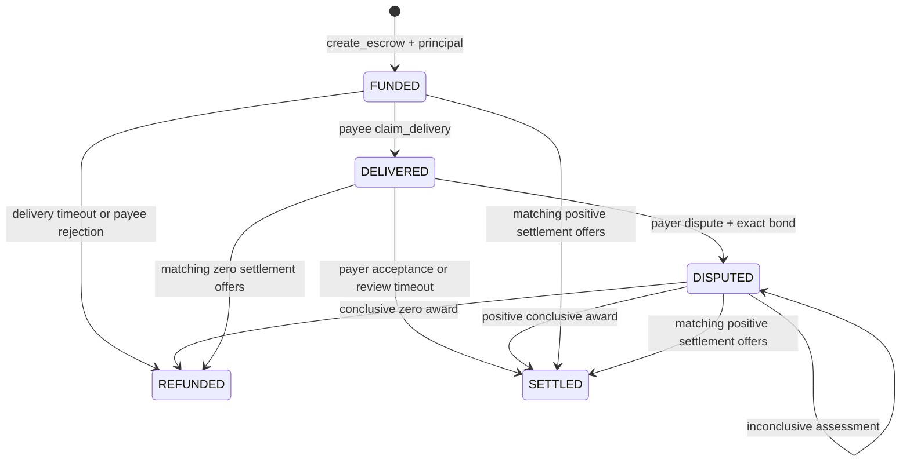

# Contract reference

## Deployment and storage

`DisputeEscrow()` deploys an empty registry. A funded `create_escrow` call creates each payment record atomically. No payment record exists without a positive principal. Native amounts are wei, with 10^18 wei per GEN. The source pins a concrete GenVM runner in its first line.

The registry stores JSON records in `TreeMap[str, str]`, payer-reference lookups in `TreeMap[str, str]`, withdrawal credits in `TreeMap[Address, u256]` and current custody liabilities in `u256` fields. Lifetime deposit and withdrawal counters use decimal strings in storage and return integers through the view, allowing total throughput to exceed a single uint256 balance. Escrow IDs are consecutive decimal strings, starting at `"1"`. Reads use direct indexed lookups. There are no scans over the registry or unbounded collection-return methods.

Payer references contain 1 to 128 characters without surrounding whitespace. A reference can be used once by each payer, including after its escrow is settled. `find_escrow` supports recovery after a submission timeout. A duplicate reference reverts rather than receiving a second payment.

The immediate message sender is the authorized party. An application's original transaction signer does not gain access through `origin_address`. A contract can therefore act as either party using its own custody and permission model.

## Lifecycle



Matching offers can settle any open phase at any share, including zero or full payment. A zero share produces `REFUNDED`; any positive share produces `SETTLED`. Both terminal states mean the principal and any dispute bond have been allocated to withdrawal credits. They do not mean a recipient has withdrawn.

Transaction timestamps determine deadlines. Delivery is allowed strictly before `delivery_deadline`; timeout refunds begin at that timestamp. Disputes are allowed strictly before `review_deadline`; uncontested release begins at that timestamp. The review deadline starts when delivery is claimed, not when the escrow is funded. Transaction time is pinned by GenVM and shared by validators. Processing delay does not turn this into a wall-clock guarantee.

The payee accepts the documented engagement when claiming delivery. The payer cannot cancel a funded engagement before its delivery deadline. The payee can reject it while still funded. This prevents the payer from withdrawing payment after the payee has begun work.

## Write methods

| Method | Caller | Preconditions and effect |
|---|---|---|
| `create_escrow(reference, payee, terms_url, terms_sha256, delivery_period, review_period, bond_bps) -> dict` | Anyone, payable | Positive native value becomes principal. Different nonzero payee, unique reference, valid committed terms. Returns an explicit acceptance result containing the escrow ID. |
| `claim_delivery(id, evidence_url, evidence_sha256)` | Payee | `FUNDED`, before delivery deadline. Commits evidence and opens review. |
| `accept_delivery(id)` | Payer | `DELIVERED`. Allocates all principal to payee. |
| `dispute(id, evidence_url, evidence_sha256) -> dict` | Payer, payable | `DELIVERED`, before review deadline, exact bond. Commits payer evidence and freezes uncontested release. |
| `adjudicate(id) -> dict` | Anyone | `DISPUTED`. Runs independent consensus assessment. Conclusive results settle; inconclusive results record a reason and preserve custody. |
| `release_expired(id)` | Anyone | `DELIVERED`, review deadline reached. Allocates all principal to payee. |
| `refund_undelivered(id)` | Anyone | `FUNDED`, delivery deadline reached. Allocates all principal to payer. |
| `reject_escrow(id)` | Payee | `FUNDED`. Allocates all principal to payer. |
| `offer_settlement(id, payee_bps)` | Payer or payee | Open escrow, integer share 0..10000. Matching current offers settle. Any bond returns to payer. |
| `cancel_offer(id)` | Payer or payee | Open escrow. Removes caller's pending settlement offer. |
| `withdraw(amount, recipient, recipient_kind)` | Credit owner | Positive integer amount within caller's credit. Recipient kind is `account` or `contract`. Debits credit and emits value on finalization. |

All write methods except `create_escrow` and `dispute` are nonpayable. Creation and dispute payments are principal and bond, separate from any network transaction fees.

Delivery and dispute transitions invalidate both existing settlement offers. A party's consent to a split before new evidence does not carry into a changed phase. Within a phase an offer remains open until replaced, cancelled or matched. Read state again before submitting acceptance of a counterparty's offer.

## Views

| Method | Return |
|---|---|
| `get_escrow(id)` | Complete record with immutable evidence snapshots, deadlines, bond, offers, last assessment and settlement credits. Unknown IDs revert. |
| `find_escrow(payer, reference)` | Decimal escrow ID or empty string if unused. |
| `credit_of(owner)` | Aggregate unwithdrawn credit in wei. |
| `get_accounting()` | Escrow count, locked principal, locked bonds, withdrawal credits, total deposits, withdrawals, accounted balance and conservation check. |
| `get_config()` | Version, asset, limits, evidence policy and transfer timing. |

The accounting view describes recorded liabilities. It does not prove actual native balance. Compare `accounted_balance` with the network balance independently, as the integration suite does. Unsolicited value transfers are not allocated to a payment record or recoverable by an administrator.

## Financial rules

For principal `P`, bond rate `b`, and conclusive payee share `s`:

```text
required_bond = ceil(P * b / 10000)
               = (P * b + 9999) // 10000
payee_principal = P * s // 10000
payer_principal = P - payee_principal
```

`b` must be an integer from 1 to 10000. The bond always contains at least one wei. The payer chooses this rate at creation, so counterparties should enforce a marketplace minimum before accepting the engagement. Consensus awards `s` in steps of 100 basis points. Bilateral agreements support every integer basis point. Fractional payout dust goes to the payer.

If consensus establishes bad faith, the payee receives the bond. Otherwise the payer receives it in full. Bad faith is valid only with a conclusive 10000-bps award. The parser rejects inconsistent findings, floating-point or string shares, booleans masquerading as integers, out-of-range shares and oversized or empty reasons.

For each settlement:

```text
payer_credit + payee_credit = P + bond_paid
```

Across the registry:

```text
total_deposited = locked_principal + locked_bonds
                  + withdrawal_credits + total_withdrawn
```

A single escrow's principal plus possible bond must fit uint256 capacity. Lifetime audit counters are decimal strings in storage and are not limited to a single native balance. Arithmetic uses Python integers before checked conversion to `u256` for current custody and credits. There is no floating-point money arithmetic.

## Rejected incoming payments

Studio's observed value behavior retains native value on a reverted payable call. The supported payable entry points therefore catch expected request and evidence-validation errors before changing escrow state. They return an explicit result and allocate all incoming value to the immediate sender's withdrawal credit:

```json
{"accepted":false,"method":"dispute","escrow_id":"","refund_credit":1001,"error":"[EXPECTED] Only payer"}
```

A valid request returns `accepted=true`, its escrow ID, zero refund credit and an empty error. A rejected creation does not use its reference or create an escrow. A rejected dispute does not change the escrow, commit evidence or lock a bond. The refund belongs to the actual sender, including an unauthorized third party. It is recorded in total deposits and withdrawal liabilities, so actual custody remains conserved.

These rejected requests execute successfully at the VM level because they preserve incoming money. Builders must inspect the application result as well as execution success. The Python binding raises `PaymentRejected` with that result and the confirmed refund credit. Nonpayable errors continue to revert. Malformed ABI calls, unsupported methods and unexpected VM failures fall under protocol value-handling rules and are not supported refund-credit entry paths.

## Evidence and consensus

Submission accepts public HTTPS DNS URLs up to 2048 characters. Ports, userinfo, literal IP addresses, fragments, whitespace and common local hostname suffixes are rejected. Documents must return HTTP 200 and contain 1..32768 raw bytes of nonempty UTF-8 text without NUL. The supplied digest is 64 lowercase SHA-256 hexadecimal characters without `0x`.

The contract hashes raw response bytes before decoding. Builders must hash the same representation, including line endings and trailing newlines. They should use raw text documents rather than rendered HTML. The network controls redirect policy and DNS resolution; the hostname filter is not a complete SSRF defense.

At submission `strict_eq` checks the fetched, digest-verified snapshot across validators. The deterministic record stores its exact text and digest. At adjudication every evaluator verifies the snapshot hash, attempts another HTTP fetch of each source, and uses the snapshot if the live content fails its commitment or becomes unavailable. This preserves the previously agreed evidence while preventing post-submission revisions.

The leader returns:

```json
{
  "conclusive": true,
  "payee_bps": 5000,
  "payer_bad_faith": false,
  "reason": "Two of four equally priced sections were delivered."
}
```

Every validator independently performs the same evidence-based model task. The custom equivalence function compares `conclusive`, `payee_bps` and `payer_bad_faith` exactly. Reason wording may differ; it does not control money. An error or invalid answer never counts as a valid assessment. Disagreement follows the network's rotation and appeal machinery.

An inconclusive result uses zero share and no bad-faith flag but does not settle at zero. It increments `assessment_count`, records `last_assessment` and leaves funds locked. Retrying is permissionless and remains subject to network fees and availability. The contract makes no autonomous background calls.

## Withdrawals and finality

Settlement is separate from transfer. The caller owns its credit and chooses an amount and destination. Partial withdrawals are allowed. Zero addresses and the registry itself are invalid destinations.

`recipient_kind="account"` uses GenVM's EVM recipient interface, which is how native transfers reach EOAs or EVM addresses. `recipient_kind="contract"` emits a finalized native-value call to `receive_escrow()` on an Intelligent Contract. The receiver must expose that public payable method. The contract callback receives no arguments; it can inspect the sender and value.

Credits are debited before the asynchronous message is emitted. Messages do not synchronously return success. A failed child call may not return the value automatically. A destination must be qualified before a large withdrawal; a small initial transfer is appropriate when its behavior is uncertain. The registry provides no acknowledgement-based refund or privileged rescue path. Follow both the finalized parent and any child transactions.

## Runtime references

The implementation follows the installed GenLayer contract, linting, direct-test, integration-test and CLI skills. Relevant public protocol and SDK documentation:

- [Native value transfers and recipient interfaces](https://docs.genlayer.com/developers/intelligent-contracts/features/value-transfers)
- [Transaction context and deterministic transaction time](https://docs.genlayer.com/developers/intelligent-contracts/features/transaction-context)
- [Studio execution and chain-layer limitations](https://docs.genlayer.com/developers/intelligent-contracts/tools/genlayer-studio/limitations)
- [GenVM runtime source and release artifacts](https://github.com/genlayerlabs/genvm)
